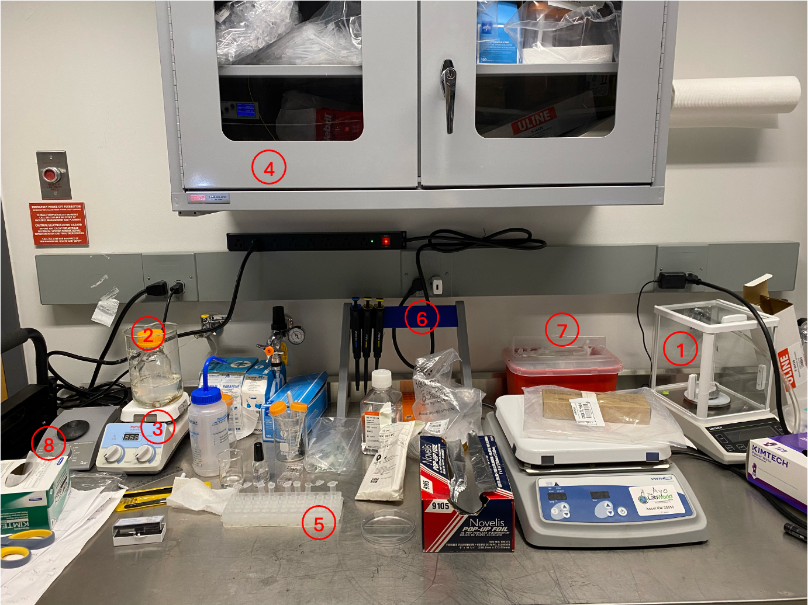
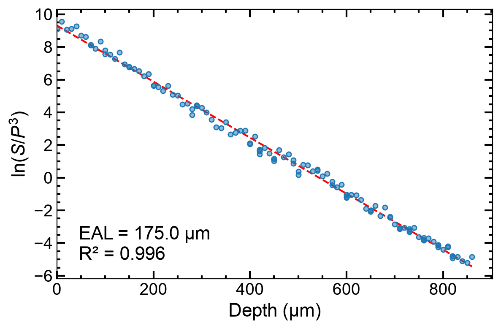

# Effective attenuation length (EAL) measurement protocol

## Materials:

- [Agarose (Sigma Aldrich A4018-10G)](https://www.sigmaaldrich.com/US/en/product/sial/a4018)
- [1-µm fluorescent beads (Thermo Fisher F13081)](https://www.thermofisher.com/order/catalog/product/F13081?SID=srch-srp-F13081); bead concentration $C_{fluo} = 1\times10^{7}\ \text{beads}/\text{µL}$
- [1-µm non-fluorescent polystyrene beads (Polysciences 07310)](https://polysciences.com/products/polybead-microspheres-100181m?srsltid=AfmBOorjVsqH1_RPydiDL_rl2QxODNqYwh8yssEixcAhqj7QJ9CAVFyL); bead concentration $C_{poly} = 4.55\times10^{7}\ \text{beads}/\text{µL}$

---

## Dilution calculation

1. Take 1 g of agarose per 100 mL of water as the base medium.
2. The tissue phantom is prepared by mixing:

- Fluorescent beads: $V_{fluo} = 9\ \text{µL}$
- Non-fluorescent polystyrene beads: $V_{poly} = 90\ \text{µL}$
- Agarose solution: $V_{ag} = 351\ \text{µL}$

&nbsp;&nbsp;&nbsp;&nbsp; (a) The concentration of fluorescent beads:

$$
\frac{C_{fluo} \times V_{fluo}}{V_{fluo} + V_{poly} + V_{ag}}
= \frac{(1 \times 10^{7}\ \text{beads}/\text{µL}) \times (9\ \text{µL})}{(9 + 90 + 351)\ \text{µL}}
= 2 \times 10^{5}\ \text{beads}/\text{µL}
$$

&nbsp;&nbsp;&nbsp;&nbsp; (b) The concentration of non-fluorescent polystyrene beads:

$$
\frac{C_{poly} \times V_{poly}}{V_{fluo} + V_{poly} + V_{ag}}
= \frac{(4.55 \times 10^{7}\ \text{beads}/\text{µL}) \times (90\ \text{µL})}{(9 + 90 + 351)\ \text{µL}}
= 9.1 \times 10^{6}\ \text{beads}/\text{µL}
$$

&nbsp;&nbsp;&nbsp;&nbsp; (c) Ratio between non-fluorescent polystyrene beads and fluorescent beads:

$$
R = \frac{9.1 \times 10^{6}\ \text{beads}/\text{µL}}{2 \times 10^{5}\ \text{beads}/\text{µL}} = 45.5 : 1
$$

---

## Equipment and Supplies

1. [Scale with 1mg precision (e.g., Amazon B0B18FVKX9)](https://www.amazon.com/LACHOI-Analytical-Electronic-Scientific-Interface（100g/dp/B0B18FVKX9/ref=sr_1_23?crid=53N44CR6E6CP&dib=eyJ2IjoiMSJ9.JxhvFY01RhwK801tdZU35q9rQTYcC2tQthYvrtRK_c9qMeJaWoobppvpIbADMv_egsUysH1QiAmutARfYbUVo3xsRe3cZ6kqu_ip90FScCJDGi5FgLu_) 
2. Heat resistant bottle for mixing and storing agarose solution
3. [Cimarec stirring hotplate (e.g., Thermo Fisher SP88854100)](https://www.labdepotinc.com/cimarec-plus-stirring-hotplate-series?hsa_acc=5326096552&hsa_ad=&hsa_cam=21108713499&hsa_grp=&hsa_kw=&hsa_mt=&hsa_net=adwords&hsa_src=x&hsa_tgt=&hsa_ver=&utm_campaign=Zombie+SKU+PMax&utm_medium=ppc&utm_source=adwords&utm_term=) 
4. [Microcentrifuge tubes (e.g., Amazon B0BBV2LMW6)](https://www.amazon.com/Microcentrifuge-Sterilized-Plastic-Storage-Without/dp/B0BBV2LMW6/ref=sr_1_4?crid=25C67XB8W2600&dib=eyJ2IjoiMSJ9.xPCQBU3akLQF9rlTcVTk80aYDqlnaLlgpIB3o61syALNo4YVZ7pK2TRhUSHHzbtyePx1n4N1VfY8Aj9sUqRUC6LP2Sn7Orz1mKqxCnoEVPYP5y-dbozyev0I&th=1)
5. [Tube rack (e.g., Amazon B0D8R66MQ1)](https://www.amazon.com/microcentrifuge-centrifuge-Holder-0-5ml-2ml-Centrifugal/dp/B0D8R66MQ1/ref=sr_1_3?crid=1ZI3PYB3G9CUW&dib=eyJ2IjoiMSJ9.YORppysqg2ETX3WIv1hENrcBaf5mFiQT1zwaMrziZxj4AO9c8Xdj1H7rB4cdGXhXPN5NPZLih2-Zv4NAnjZxWRS0aKGhmVgp_CD9SMFMh5y9FSw52Hk&th=1) 
6. Pipettes covering [2–20 µL (e.g., Thermo Fisher F2-20R)](https://pipette.com/F2-20R.html?Category_Code=ref-pip-thermo-fisher), [20–200 µL (e.g., Thermo Fisher F2-200R)](https://pipette.com/finnpipette-f2-adjustable-volume-single-channel-pipettes.html), and [100–1000 µL (e.g., Thermo Fisher F2-1000R)](https://pipette.com/F2-1000R.html?Category_Code=single-channel-pipettes) volume ranges, stored in a pipette stand 
7. Sharps disposal container (requested from the BU EHS department)
8. [Vortexer (e.g., VWR IKA Model MV1)](https://www.marshallscientific.com/VWR-IKA-Model-MV1-Vortexer-p/vwr-ika.htm?srsltid=AfmBOop9bjFGTjvm6mfIoLMPdbEW2Kp7j4NSZWPVejsxydbgDRdUsfgK)

**Additional items not labeled in the figure:**

- [Beaker used as a water bath for heating and maintaining the agarose solution (e.g., Amazon B08X6KP8PS)](https://www.amazon.com/Feekoon-Measuring-Graduated-Cylinder-Cylinders/dp/B08X6KP8PS/ref=sr_1_4?dib=eyJ2IjoiMSJ9.fkiy-8L7Je-EhWoATqCnvyxkq-v-FXMNVzCA7z-qGeDNDcs54P547jp8ul-74plALojN6ZS2jLbsIO2a_mj1rIs66-stxX9k9EgyGbAiZ4CkSnhwNJoL-2j5WdnW8k42mjKDnWgq5s6cqeG)
- [Magnetic stir bar (Amazon B08433BR2B)](https://www.amazon.com/Magnetic-Stirrer-Mixer-Laboratory-Magnet/dp/B08433BR2B/ref=sr_1_2_sspa?crid=196CI2UFZHRCA&dib=eyJ2IjoiMSJ9.BECz6XLmK0t2h23_xptReyUTl5H8ZWBFAkGMivEEslBczVqOcwe5r1wQVG_yIOzjQ9UYQqf0aYLCqZXuW098UgIffXQruAhnDwCammP35x5B738wfu_AB1LG1uUR9&th=1)
- [Thick cavity well slide (e.g., United Scientific CSTK01 1-Concavity slide; 75 mm × 25 mm, 3 mm thick, concavity diameter ~16 mm, depth ~0.8 mm)](https://www.labdepotinc.com/p-12937-cavity-slides?utm_term=&utm_campaign=Zombie+SKU+PMax&utm_source=adwords&utm_medium=ppc&hsa_acc=5326096552&hsa_cam=22295522342&hsa_grp=&hsa_ad=&hsa_src=x&hsa_tgt=&hsa_kw=&hsa_mt=&hsa_net=adwords&hsa_ver=3&gad_source=1&ga)
- [Coverslip (e.g., Thorlabs CG15CH2, #1.5H thickness, 22 mm × 22 mm)](https://www.thorlabs.com/item/CG15CH2)
- [Cotton swab (e.g., VWR International 10806-000-PK)](https://www.labdepotinc.com/p-64-cotton-tipped-wooden-applicators?utm_term=&utm_campaign=Performance+Max+-+AGT&utm_source=adwords&utm_medium=ppc&hsa_acc=5326096552&hsa_cam=15278638752&hsa_grp=&hsa_ad=&hsa_src=x&hsa_tgt=&hsa_kw=&hsa_mt=&hsa_net=adwords&hsa)
- [Nail polish (e.g., Amazon B0046MLZLG)](https://www.amazon.com/Sally-Hansen-Advanced-Nails-Fluid/dp/B0046MLZLG?th=1)
- [Krazy Glue (e.g., Amazon B0BXMWDM42)](https://www.amazon.com/Krazy-Glue-EPIKG86648R-KG86648R-All-Purpose/dp/B0BXMWDM42/ref=sr_1_8?crid=2H3DLY2HBZ1CP&dib=eyJ2IjoiMSJ9.ZVQWAnzUL49sypVj2K7n-leSSrUo7HbydfUd-yI2bc795v5Pu9ScxNl3HniW7hCEcXaGtl3xIBKb4z0qt5psn8JYd0jh3G0daA0tnMldLPD4FYgdFbVpa6mZ_Phrbjb&th=1)

---

## Sample preparation

Sample preparation setup

1. **Prepare bulk agarose stock.**

If the agarose stock is not available, prepare fresh agarose stock following the steps below:

- Weigh 1 g of agarose powder using the [scale](#eq-scale). Add the agarose powder to 100 mL of DI water in the [container](#eq-bottle), and place a [magnetic stir bar](#eq-stirbar) into the container.
- Place the container into a [beaker](#eq-beaker), then pour 200 mL of water into the beaker.
- Place the beaker on the [stirring hotplate](#eq-hotplate).
- Set the hotplate temperature to 150 °C and set the stirring speed to 7. Heat until the agarose is fully dissolved and the solution becomes clear (approximately 30 min).
- If we follow this step to prepare fresh agarose stock, skip step 2.

If the agarose stock is available, reheat it following the steps below:

- Slightly unscrew the cap of container of agarose.
- Turn on the [stirring hotplate](#eq-hotplate) and set the stirring speed to 7. Heat until the agarose is fully dissolved and the solution becomes clear (approximately 30 min).

2. **Prepare the tissue phantom sample slide.**

- Retrieve one [microcentrifuge tube](#eq-tubes) from the cabinet and place it into the [tube rack](#eq-rack). Using the pipettes from the pipette stand, pipette 9 µL of fluorescent beads with a [2–20 µL pipette](#eq-pipettes) and 90 µL of non-fluorescent polystyrene beads with a [20–200 µL pipette](#eq-pipettes) into the same tube. Dispose of the pipette tips into the [sharps container](#eq-sharpcontainer).
- Using a [100–1000 µL pipette](#eq-pipettes), pipette 351 µL of agarose from the container and dispense it into the same microcentrifuge tube. Keep the pipette tip below the liquid surface to avoid bubbles, and mix by pipetting up and down quickly to ensure even mixing before the agarose starts to gel. Be sure to avoid generating bubbles during the process.
- Turn on the [mini vortexer](#eq-vortexer) and set the speed to 1400 rpm. Place the tube on the vortexer and mix thoroughly (approximately 40 second). 
- Using a [100–1000 µL pipette](#eq-pipettes), pipette 351 µL of the mixture and dispense it into the [cavity slide](#eq-slide).
- Slowly lower the [coverslip](#eq-coverslip) from the side so that it gently covers the sample on the cavity slide and avoid pressing down forcefully to reduce bubble formation.
- Lightly press the coverslip with a [cotton swab](#eq-swab) to squeeze out excess liquid, which is wiped out from the edges using a cotton swab to keep the edges clean.
- Apply [nail polish](#eq-polish) to the four edges of the coverslip first to fix it in place and allow it to dry for approximately 5 mins.
- Once the [nail polish](#eq-polish) is dry, apply [glue](#eq-glue) along the four edges of the [coverslip](#eq-coverslip) to further enhance the seal.
- Mark the date and name of the sample on the slide.

3. **Store the sample.**

- Reduce the hotplate temperature and stirring speed to 0, then switch the [stirring hotplate](#eq-hotplate) off.
  > ⚠️ **Fire hazard:** Never leave the hotplate running unattended. If the water bath fully evaporates while the heater is still on, the residual agarose will carbonize and the container can ignite.
- Store the remaining agarose at room temperature and let it solidify into a gel as it cools. Screw the cap onto the heat-resistant bottle to prevent water evaporation, but not too tight to allow air to flow in to the container as the sample cools down.

---

## EAL measurement

1. **System Bootup and Power Calibration**

For this measurement, we need to know the exact excitation light power under the objective lens during image acquisition. This usually requires a calibration step, and we describe it below for a system using Pockels cells to control excitation light power:

- Turn on the laser, set the laser to the desired wavelength, and wait for it to warm up until its power stabilizes. Normally, it takes 10-30 minutes depending on the laser.
- Turn on the multi-photon microscope. Keep the room as dark as possible before turning on photomultiplier detectors. Carefully examine if there are any external light sources that can leak into the detector.
- Place a power meter with appropriate range after the objective lens. Usually one can use a thermal power meter. For semiconductor power meters, it is more preferable to use an integration sphere, especially for high NA objective lens. Open the laser shutter and observe power readings.
- Gradually increase the Pockels cell control voltage and record the corresponding laser power after the beam passes through the objective lens.
- Repeat the procedure and establish a lookup table between Pockels cell control voltage and the absolute optical power after the objective lens. Since the relation is nonlinear, some interpolation may be needed later on.

2. **Background Measurement**

- Keep the laser shutter closed, and acquire multiple images _under exactly the same imaging condition and image acquisition configurations as the rest of imaging sessions_, except that the excitation laser is blocked.
- One can choose to take these background frames at any point during the experiment. Sometimes it is preferred to take them at both the beginning and the end of the image experiment to verify that the background stayed constant throughout the experiment session.

3. **Locating Sample and its Surface**

- Place the tissue phantom slide on the microscope sample stage. Bring the objective lens close to the sample surface (at a distance less than its working distance, e.g., 1 mm). Apply immersion medium between the objective and the slide.
- Set the laser power after the objective to a relatively low power, normally 1-2 mW, but this depends heavily on the system. Turn on laser scanning mirrors and begin streaming images. Gradually move the objective lens away from the sample at a fixed step size of typically 10-20 µm until fluorescence signal is first observed. 
- Continue to bring the objective lens away from the sample until the fluorescence bead images disappear abruptly; this marks the location of a sample surface (If a THG channel is also available, one can corroborate this by seeing a strong transient THG signal generated at the interface between the lower surface of the coverslip and the sample). If possible, reset the z-coordinate of the sample surface to 0; otherwise, note down its coordinate. Regardless of the numerical value, the sample surface is denoted as $z_0$.

4. **Verification of the Power Scaling of Multi-photon Excitation**

Before measuring the effective attenuation length (EAL), first determine an excitation power at which the fluorescence signal has negligible excitation saturation.

- At the sample surface $z_0$, acquire images at a given excitation power $P$, then at $2P$, without moving the sample or changing any other imaging configuration. Note down both excitation powers.
- Subtract the background (see step 2, Background Measurement) and define the bead signal as the mean intensity of the top 0.1% brightest pixels.
- For 3PE, verify that the signal at $2P$ is approximately 8 times the signal at $P$. If not, reduce the excitation power and repeat until the ratio is about 8. If no images are visible at low excitation power, troubleshoot the noise level and the signal collection efficiency of the system.
- Determine the maximum non-saturating excitation power at the sample surface and record the corresponding bead signal as $S_{\text{surface}}$. Alternatively, the excitation saturation can be verified with our tool; see [LINK_TBD](#) <!-- TODO: add link to the saturation verification tool -->.

5. **Acquisition of a Depth Image Stack**

- Using the maximum non-saturating power from step 4, acquire images at 10 µm z-steps while moving deeper into the sample, until the bead signal approaches the background.
- Increase the excitation power to restore the bead signal to approximately $S_{\text{surface}}$, move the sample 20 µm away from the objective (so the new power level overlaps the previous depths), and continue acquiring images at 10 µm steps deeper into the sample.
- Repeat until the bead signal can no longer be distinguished from the background, or the laser reaches its maximum power.
- For each image, record its excitation power (Pockels cell setting) and imaging depth.

---

## Data processing ([Example](https://github.com/TYW-Lab/EAL_measurement_protocol/tree/main/example))

1. **Background Subtraction**

- Calculate the mean pixel value of the background images (averaged over all pixels of all background frames) to obtain a single background value. Refer to [the procedure](#eal-measurement) describing how the background images were acquired.
- Subtract this single background value from every pixel of all fluorescence images.
- Negative values after subtraction are clipped to zero (for regular bitmap images).

2. **EAL Fitting**

- At each depth, identify the corresponding excitation power $P$ (converted from the Pockels cell setting using the lookup table from step 1 of [EAL measurement](#eal-measurement)) and the measured signal $S$ (the mean intensity of the brightest 0.1% of pixels after background subtraction).
- Normalize the signal by $P^3$ and take the natural logarithm:

$$
y = \ln \left(S/P^3\right)
$$

- Fit $y$ as a linear function of depth $z$. If the fitted slope is $k$, calculate the EAL as

$$
\text{EAL} = -\frac{3}{k}
$$

- An example of the EAL fit is shown in the figure below.

